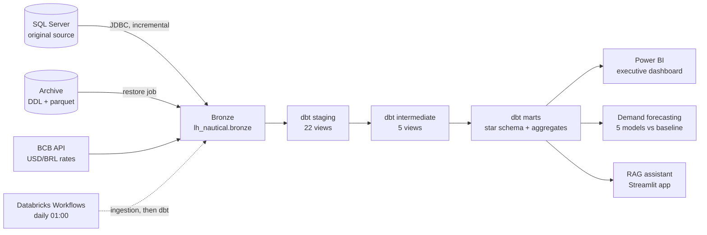

# Lighthouse: a Databricks data platform for a nautical retailer

An end-to-end data project on Databricks, built during the Indicium AI Lighthouse Trainee program: ingestion into a Bronze layer, dbt transformations into a star schema, LGPD governance, orchestration, a Power BI dashboard, a demand-forecasting study and a retrieval-augmented chat assistant. Originally hosted on Bitbucket and moved to GitHub in November 2026.

**[dbt documentation site](https://leopinho1777.github.io/databricks-lighthouse-project/)**: every model, column, test, source, seed, snapshot and macro, with the lineage graph.

The data is a **mock database** of a fictional nautical retailer (LH Nautical). It is static: no new data arrives.

## Architecture



| Layer | What it holds | Where |
| :--- | :--- | :--- |
| Bronze | 24 source tables, BCB exchange rates, ingestion control and audit tables (Delta, Unity Catalog) | [`databricks/ingestion`](databricks/ingestion) |
| Staging | 1:1 cleanup, typing and deduplication of Bronze | [`dbt/models/staging`](dbt/models/staging) |
| Intermediate | Cross-entity business logic (categorized products, enriched sales, purchases, returns) | [`dbt/models/intermediate`](dbt/models/intermediate) |
| Marts | 7 dimensions, 4 facts, 6 pre-aggregated tables for BI | [`dbt/models/marts`](dbt/models/marts) |

## Highlights

* **Incremental ingestion with audit and alerting.** Single-key tables load by watermark; composite-key tables do a full reload with MERGE. Every run is idempotent, audited per table, and the BCB exchange-rate task sends an alert email only after three consecutive failed days; each run re-fetches the last 15 days, so short outages fill themselves in.
* **Tested dbt project.** 44 models, 414 tests, 1 snapshot (SCD2 stock history) and 1 seed. A full `dbt build` ends with 459 of 460 nodes passing, 1 warning and no errors. The warning is expected: the source keeps only current stock levels, so the snapshot has no accumulated history to reconcile movements against. In production, successive snapshots would build that history. Shared macros handle deduplication, data-quality filters and USD/BRL conversion.
* **Star schema built for BI.** Dimensions include an SCD2 customer-address history; aggregates (customer LTV and churn risk, product contribution margin, daily and regional sales) are shaped for Power BI. See the [dashboard guide](docs/dashboard_guide.md).
* **LGPD governance.** Dynamic column masking through a Unity Catalog function driven by a JSON policy, plus role-based grants, implemented as notebooks for the original project workspace. Credentials come from Databricks secrets, never from code.
* **Honest forecasting study.** Eleven stages from data exploration to a five-model comparison (regression, Random Forest, XGBoost, Prophet, SARIMA), all scored under one protocol against a seasonal-naive baseline. Result: no model beats the baseline in three or more of four windows, and forecasts are only usable at category x location level (11-39% WAPE for the two best models). The likely reasons are sparse demand (25-59% of product x location series sell nothing in a 91-day window), an annual cycle the baseline already captures, and synthetic data with no external signal to learn. Full write-up: [`forecasting/OVERVIEW.md`](forecasting/OVERVIEW.md).
* **Grounded chat assistant.** A RAG app on Databricks Vector Search where numbers are rendered from Delta columns before indexing, so the model phrases answers but never produces a fact. See [`databricks/rag`](databricks/rag/README.md).

## Tech stack

| Area | Tools |
| :--- | :--- |
| Platform | Databricks (Unity Catalog, Delta Lake, Workflows, Asset Bundles, Vector Search, Apps), serverless compute |
| Transformation | dbt (`dbt_utils`), SQL, Jinja macros |
| Ingestion | PySpark, JDBC (SQL Server), REST (BCB), a custom Python package (`grupo10`) |
| Forecasting | statsmodels, linearmodels, scikit-learn, XGBoost, Prophet, MLflow |
| Serving | Streamlit, Databricks Foundation Model APIs, Power BI |
| Tooling | `uv`, `ruff`, `pytest` |

## Repository layout

```
databricks/
  ingestion/        Bundle "grupo10": SQL Server and BCB ingestion, restore job, governance notebooks
  transformation/   Bundle "transformation": runs `dbt build` as a Databricks job
  orchestration/    Bundle "orchestration": chains ingestion -> transformation on a daily schedule
  rag/              Bundle for the RAG chat assistant (Streamlit app + offline indexing pipeline)
dbt/                dbt project "desafio_lh": staging -> intermediate -> marts
forecasting/        Demand-forecasting analysis (not deployed): baselines, features, model experiments
docs/               Power BI dashboard guide
```

Each bundle has its own `databricks.yml` and is deployed on its own; there is no single root bundle. The `prod` targets keep the original project workspace as a reference; to deploy elsewhere, set your host there, and in `orchestration` also the two job ids.

## Running it

You need a Databricks workspace with Unity Catalog, the [Databricks CLI](https://docs.databricks.com/dev-tools/cli/), [`uv`](https://docs.astral.sh/uv/), dbt with the Databricks adapter and a SQL warehouse. The original SQL Server source is no longer available, so the Bronze layer is rebuilt from an archive of the Bronze tables (`ddl/*.sql` and `parquet/*.parquet`) that is not part of this repository.

```bash
# 1. Install dependencies and authenticate
uv sync --dev
databricks auth login

# 2. Point the bundles at your workspace: create databricks.local.yml at the repo root (git-ignored)
#    targets:
#      dev:
#        workspace: {host: https://<your-databricks-workspace>, profile: <your-profile>}
#        variables: {catalog: lh_nautical, schema: bronze}

# 3. Restore Bronze: upload the archive to the volume <catalog>.<schema>.archive, then
cd databricks/ingestion
databricks bundle deploy --target dev
databricks bundle run restore --target dev        # re-runnable; replaces the 28 Bronze tables

# 4. Build the star schema (profile "desafio_lh" in ~/.dbt/profiles.yml, catalog = the Bronze catalog)
cd ../../dbt
dbt deps
dbt build --target prod                           # schemas: staging, intermediate, marts, snapshots
dbt docs generate
```

With the original SQL Server available, `databricks bundle run ingestion` runs the incremental ingestion instead of the restore job (it reads credentials from the `sqlserver` secret scope). See the READMEs for [dbt](dbt/README.md), [orchestration](databricks/orchestration/README.md), [RAG](databricks/rag/README.md) and [forecasting](forecasting/README.md).

## Data notes

* The source data contains future-dated records. As part of the challenge, each team chose how to treat them: some simulated them as new records arriving in later ingestions, others treated them as invalid. Our team chose the latter and filters them out in dbt (`filter_valid_orders()` and related macros in [`dbt/macros`](dbt/macros)).
* The Bronze archive holds each row twice in 22 tables (one copy of each pair has null ingestion metadata). Staging models keep the latest version of each key with `dedupe_latest()`. Query the dbt layers, not Bronze, for analysis.

## Team

The project ran for five months in five deliveries, each focused on a different part of the platform. For each one, the team presented and defended its design choices. From the second delivery on, a different member acted as Tech Lead and was responsible for its technical direction.

Team members: Gabriel Henrique Silva, Eva Carrasquel, Leonardo Pinho and Eros Boni.

| # | Delivery | Tech Lead |
| :--- | :--- | :--- |
| 1 | Discovery | none |
| 2 | Ingestion and orchestration | Leonardo Pinho |
| 3 | Modeling | Gabriel Henrique Silva |
| 4 | Data visualization | Eva Carrasquel |
| 5 | Predictive modeling and delivery | Eros Boni |
