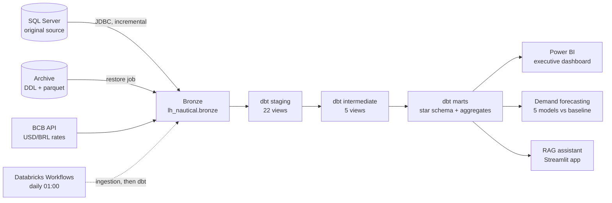

# Lighthouse: a Databricks data platform for a nautical retailer

An end-to-end data project built by Group 10 (TeslaVinci) on Databricks: ingestion into a Bronze layer, dbt transformations into a star schema, LGPD governance, orchestration, a Power BI dashboard, a demand-forecasting study and a retrieval-augmented chat assistant.

**[Browse the dbt documentation site](https://leopinho1777.github.io/databricks-lighthouse-project/)**: every model, column, test, source, seed, snapshot and macro, with the lineage graph.

The data is a **mock database** of a fictional nautical retailer (LH Nautical), used for learning. It does not update in production.

## Architecture



| Layer | What it holds | Where |
| :--- | :--- | :--- |
| Bronze | 24 source tables, BCB exchange rates, ingestion control and audit tables (Delta, Unity Catalog) | [`databricks/ingestion`](databricks/ingestion) |
| Staging | 1:1 cleanup, typing and deduplication of Bronze | [`dbt/models/staging`](dbt/models/staging) |
| Intermediate | Cross-entity business logic (categorized products, enriched sales, purchases, returns) | [`dbt/models/intermediate`](dbt/models/intermediate) |
| Marts | 7 dimensions, 4 facts, 6 pre-aggregated tables for BI | [`dbt/models/marts`](dbt/models/marts) |

## Highlights

* **Incremental ingestion with audit and alerting.** Single-key tables load by watermark; composite-key tables do a full reload with MERGE. Every run is idempotent, audited per table, and the BCB exchange-rate task only sends an alert email after consecutive failures, not a single blip.
* **Tested dbt project.** 44 models, 414 tests, 1 snapshot (SCD2 stock history) and 1 seed. A full `dbt build` ends with 455 of 460 nodes passing, 5 warnings and no errors. Shared macros handle deduplication, data-quality filters and USD/BRL conversion.
* **Star schema built for BI.** Dimensions include an SCD2 customer-address history; aggregates (customer LTV and churn risk, product contribution margin, daily and regional sales) are shaped for Power BI. See the [dashboard guide](docs/dashboard_guide.md).
* **LGPD governance.** Dynamic column masking through a Unity Catalog function driven by a JSON policy, plus role-based grants. Credentials come from Databricks secrets, never from code.
* **Honest forecasting study.** Eleven stages from data exploration to a five-model comparison (regression, Random Forest, XGBoost, Prophet, SARIMA), all scored under one protocol against a seasonal-naive baseline. Result: no model beats the baseline in three or more of four windows, and forecasts are only usable at category x location level (11-39% WAPE). The write-up explains why. See [`forecasting/`](forecasting/OVERVIEW.md).
* **Grounded chat assistant.** A RAG app on Databricks Vector Search where numbers are rendered from Delta columns before indexing, so the model phrases answers but never produces a fact. See [`databricks/rag`](databricks/rag/README.md).

## Tech stack

| Area | Tools |
| :--- | :--- |
| Platform | Databricks (Unity Catalog, Delta Lake, Workflows, Asset Bundles, Vector Search, Apps), serverless compute |
| Transformation | dbt (`dbt_utils`), SQL, Jinja macros |
| Ingestion | PySpark, JDBC (SQL Server), REST (BCB), Python package `grupo10` |
| Forecasting | statsmodels, linearmodels, scikit-learn, XGBoost, Prophet, MLflow |
| Serving | Streamlit, Databricks Foundation Model APIs, Power BI |
| Tooling | `uv`, `ruff`, `pytest` |

## Repository layout

```
databricks/
  ingestion/        Bundle "grupo10": SQL Server and BCB ingestion, restore job, governance notebooks
  transformation/   Bundle "transformation": runs `dbt build` as a Databricks job
  orchestration/    Bundle "orchestration": chains ingestion -> transformation on a daily schedule
  rag/              Bundle for the RAG chat assistant (Streamlit app + offline indexing pipeline)
dbt/                dbt project "desafio_lh": staging -> intermediate -> marts
forecasting/        Demand-forecasting analysis (not deployed): baselines, features, model experiments
docs/               Power BI dashboard guide
```

Each bundle has its own `databricks.yml` and is deployed on its own; there is no single root bundle.

## Running it

You need a Databricks workspace with Unity Catalog, the [Databricks CLI](https://docs.databricks.com/dev-tools/cli/), [`uv`](https://docs.astral.sh/uv/) and a SQL warehouse. The original SQL Server source is no longer available, so the Bronze layer is rebuilt from an archive of the Bronze tables (`ddl/*.sql` and `parquet/*.parquet`) that is not part of this repository.

```bash
# 1. Install dependencies and authenticate
uv sync --dev
databricks auth login

# 2. Point the bundles at your workspace: create databricks.local.yml at the repo root (git-ignored)
#    targets:
#      dev:
#        workspace: {host: https://<your-workspace>, profile: <your-profile>}
#        variables: {catalog: lh_nautical, schema: bronze}

# 3. Restore Bronze: upload the archive to the volume <catalog>.<schema>.archive, then
cd databricks/ingestion
databricks bundle deploy --target dev
databricks bundle run restore --target dev        # re-runnable; replaces the 28 Bronze tables

# 4. Build the star schema (profile "desafio_lh" in ~/.dbt/profiles.yml, catalog = the Bronze catalog)
cd ../../dbt
dbt deps
dbt build --target prod                           # schemas: staging, intermediate, marts, snapshots
dbt docs generate
```

With the original SQL Server available, `databricks bundle run ingestion` runs the incremental ingestion instead of the restore job (it reads credentials from the `sqlserver` secret scope). The dbt models and the other bundles are described in [`dbt/README.md`](dbt/README.md) and [`forecasting/README.md`](forecasting/README.md).

## Data notes

* The source data contains future-dated records. The team decided to filter them out in dbt (`filter_valid_orders()` and related macros in [`dbt/macros`](dbt/macros)).
* The Bronze archive holds each row twice in 22 tables (half of the copies have null ingestion metadata). Staging models keep the latest version of each key with `dedupe_latest()`. Query the dbt layers, not Bronze, for analysis.

## Status and limitations

* The ingestion job reads from a SQL Server that no longer exists; its code is kept, and the restore job replaces it for rebuilding Bronze.
* The governance notebooks (masking function and grants) were written for the original workspace and have not been re-applied to the current one.
* The `transformation` and `orchestration` bundles still reference the original workspace (host and job ids) and need updating before they can be deployed elsewhere.
* There is no automated CI yet; `pytest`, `ruff` and `dbt build` are run by hand.
* The forecasting models do not beat the seasonal-naive baseline at product x location level. This is a documented result, not an open bug.

## Team

| Person | Area |
| :--- | :--- |
| Eva Carrasquel | Tech lead; fixed-effects regression experiment |
| Gabriel Henrique Silva | Analytics engineering; XGBoost experiment |
| Leonardo Pinho | Data engineering: ingestion and the restore job, dbt models and the transformation bundle, SARIMA experiment, docs site |
| Eros Boni | Random Forest and Prophet experiments |
