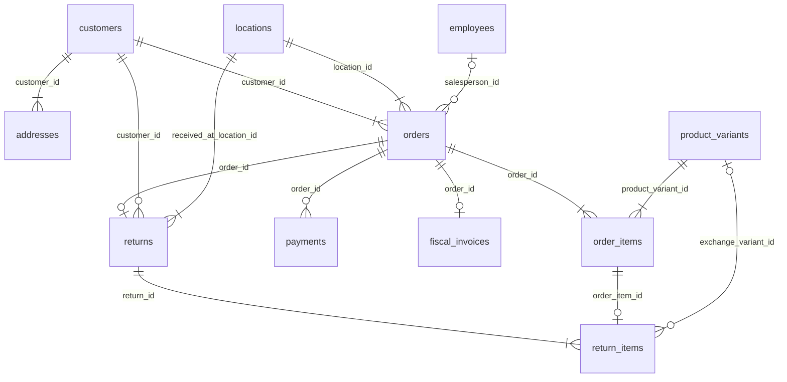
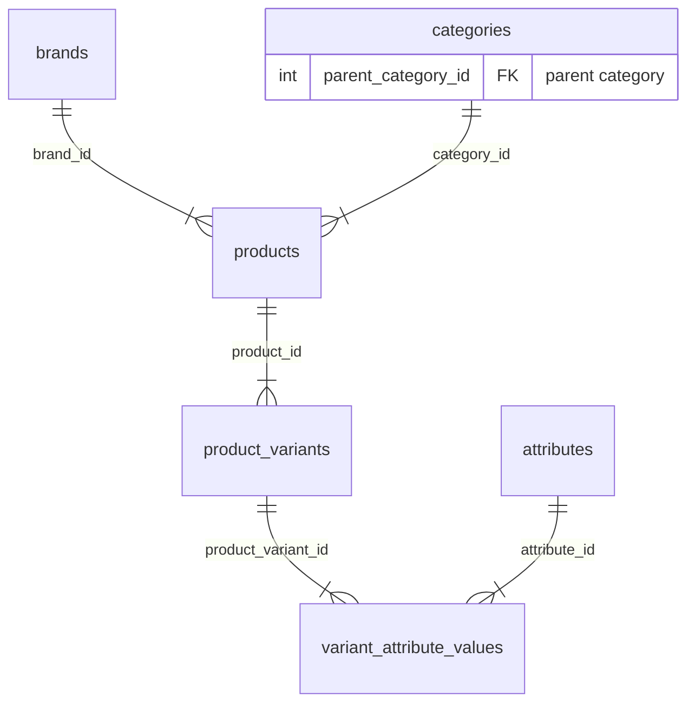
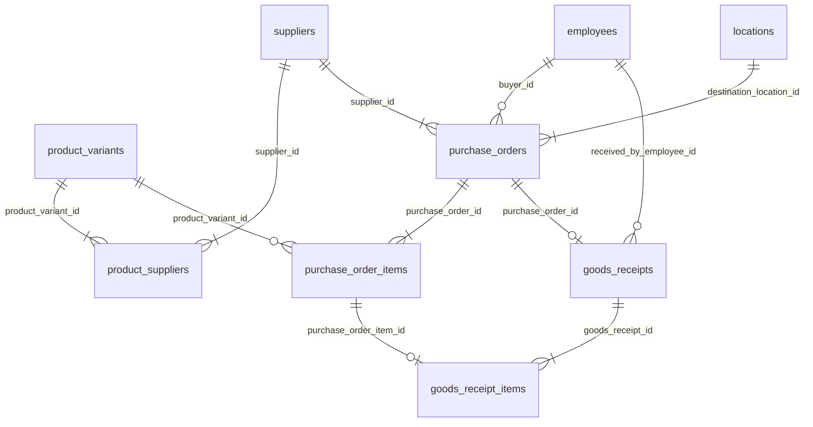
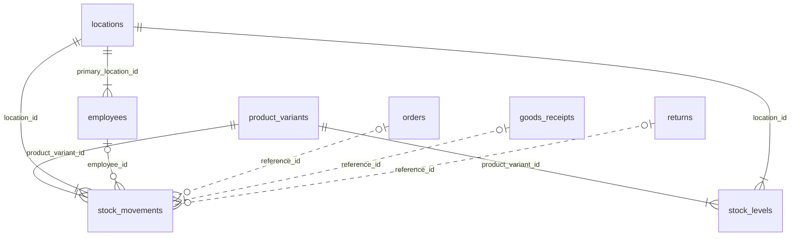

# Source data

The Bronze layer of the Lighthouse project: the tables this pipeline ingests and transforms. This folder holds the table definitions and small samples that can be read on GitHub. The complete rows are Parquet files, distributed as a [release download](#download-and-restore) instead of being stored in the repository.

> **Synthetic data.** LH Nautical is a fictional company. The dataset was provided by Indicium AI for the Lighthouse Trainee program and is shared with permission. Names, tax IDs, emails, phone numbers and addresses are mock values; any match with a real person or company is coincidental.

## What is in this folder

| Path | Contents |
| :--- | :--- |
| [`ddl/`](ddl) | One `CREATE TABLE` statement per table (28) |
| [`samples/`](samples) | One CSV file per table with related sample rows (28) |
| [`build_samples.py`](build_samples.py) | Rebuilds the samples from the Parquet archive |

## Download and restore

[`bronze-archive.zip`](https://github.com/leopinho1777/databricks-lighthouse-project/releases/download/data-v1/bronze-archive.zip) (about 12 MB, release `data-v1`) contains a `sqlserver_bronze/` folder with `ddl/` and `parquet/` for all 28 tables.

SHA-256: `ae611aed7341fbf6ff911a4ca4920614b6b788ae97a14a8aeb96cb7a7fe275c0`

Restoring it needs a Databricks workspace with Unity Catalog and an authenticated [Databricks CLI](https://docs.databricks.com/dev-tools/cli/). First complete steps 1 and 2 of [Running it](../README.md#running-it); the catalog and schema below must match the ones set there.

Create the catalog in the Databricks SQL editor. Use SQL for this step: on workspaces with Default Storage, `databricks catalogs create` fails unless you give a storage location.

```sql
CREATE CATALOG IF NOT EXISTS lh_nautical;
```

Then run:

```bash
# 1. Download, verify and unzip, outside the repository
mkdir -p ~/lighthouse-data && cd ~/lighthouse-data
curl -LO https://github.com/leopinho1777/databricks-lighthouse-project/releases/download/data-v1/bronze-archive.zip
echo "ae611aed7341fbf6ff911a4ca4920614b6b788ae97a14a8aeb96cb7a7fe275c0  bronze-archive.zip" | sha256sum -c -
unzip bronze-archive.zip

# 2. Create the schema and volume, and upload the folder (skip what already exists)
databricks schemas create bronze lh_nautical
databricks volumes create lh_nautical bronze archive MANAGED
databricks fs cp -r sqlserver_bronze dbfs:/Volumes/lh_nautical/bronze/archive/sqlserver_bronze

# 3. Restore the tables, from the repository root
cd <path-to-repository>/databricks/ingestion
databricks bundle deploy --target dev
databricks bundle run restore --target dev
```

The restore job creates or replaces the 28 tables and checks that each one holds as many rows as its Parquet file. See [Table definitions and masking](#table-definitions-and-masking) before running it on a workspace with masked tables.

## Tables

28 tables and 448,846 rows: 24 tables copied from the SQL Server source, the exchange rates and 3 pipeline control tables. Row counts refer to the complete data, not to the samples.

### Sales and customers

| Table | Description | Primary key | Rows | Files |
| :--- | :--- | :--- | ---: | :--- |
| `customers` | Individuals (PF) and companies (PJ); personal data | `id` | 2,000 | [DDL](ddl/customers.sql), [sample](samples/customers.csv) |
| `addresses` | Customer postal addresses | `id` | 3,998 | [DDL](ddl/addresses.sql), [sample](samples/addresses.csv) |
| `orders` | Sales order headers | `id` | 50,000 | [DDL](ddl/orders.sql), [sample](samples/orders.csv) |
| `order_items` | Sales order lines, one per product variant sold | `id` | 150,321 | [DDL](ddl/order_items.sql), [sample](samples/order_items.csv) |
| `payments` | Payments against sales orders | `id` | 54,635 | [DDL](ddl/payments.sql), [sample](samples/payments.csv) |
| `fiscal_invoices` | Fiscal invoices (NF-e) of sales orders | `id` | 35,079 | [DDL](ddl/fiscal_invoices.sql), [sample](samples/fiscal_invoices.csv) |
| `returns` | Return headers | `id` | 1,000 | [DDL](ddl/returns.sql), [sample](samples/returns.csv) |
| `return_items` | Returned items and the action taken (refund or exchange) | `id` | 1,409 | [DDL](ddl/return_items.sql), [sample](samples/return_items.csv) |

### Product catalog

| Table | Description | Primary key | Rows | Files |
| :--- | :--- | :--- | ---: | :--- |
| `products` | Base products | `id` | 500 | [DDL](ddl/products.sql), [sample](samples/products.csv) |
| `product_variants` | Sellable variants (SKUs) with price, cost and tax rates | `id` | 1,009 | [DDL](ddl/product_variants.sql), [sample](samples/product_variants.csv) |
| `categories` | Category hierarchy | `id` | 14 | [DDL](ddl/categories.sql), [sample](samples/categories.csv) |
| `brands` | Product brands | `id` | 12 | [DDL](ddl/brands.sql), [sample](samples/brands.csv) |
| `attributes` | Attribute catalog, such as color or size | `id` | 8 | [DDL](ddl/attributes.sql), [sample](samples/attributes.csv) |
| `variant_attribute_values` | Attribute values of each variant | `product_variant_id`, `attribute_id` | 2,018 | [DDL](ddl/variant_attribute_values.sql), [sample](samples/variant_attribute_values.csv) |

### Purchasing

| Table | Description | Primary key | Rows | Files |
| :--- | :--- | :--- | ---: | :--- |
| `suppliers` | Suppliers with contact and tax data | `id` | 25 | [DDL](ddl/suppliers.sql), [sample](samples/suppliers.csv) |
| `product_suppliers` | Which suppliers provide each variant, with cost and lead time | `product_variant_id`, `supplier_id` | 1,520 | [DDL](ddl/product_suppliers.sql), [sample](samples/product_suppliers.csv) |
| `purchase_orders` | Purchase order headers | `id` | 2,000 | [DDL](ddl/purchase_orders.sql), [sample](samples/purchase_orders.csv) |
| `purchase_order_items` | Purchase order lines | `id` | 6,059 | [DDL](ddl/purchase_order_items.sql), [sample](samples/purchase_order_items.csv) |
| `goods_receipts` | Deliveries received against purchase orders | `id` | 1,548 | [DDL](ddl/goods_receipts.sql), [sample](samples/goods_receipts.csv) |
| `goods_receipt_items` | Received items, linked to purchase order lines | `id` | 4,733 | [DDL](ddl/goods_receipt_items.sql), [sample](samples/goods_receipt_items.csv) |

### Locations, staff and stock

| Table | Description | Primary key | Rows | Files |
| :--- | :--- | :--- | ---: | :--- |
| `locations` | Stores and warehouses | `id` | 6 | [DDL](ddl/locations.sql), [sample](samples/locations.csv) |
| `employees` | Employees, including salespeople and buyers; personal data | `id` | 15 | [DDL](ddl/employees.sql), [sample](samples/employees.csv) |
| `stock_levels` | Current stock per variant and location | `product_variant_id`, `location_id` | 6,054 | [DDL](ddl/stock_levels.sql), [sample](samples/stock_levels.csv) |
| `stock_movements` | Stock entries and exits | `id` | 117,427 | [DDL](ddl/stock_movements.sql), [sample](samples/stock_movements.csv) |

### Exchange rates and pipeline tables

These are produced by the pipeline and do not come from SQL Server.

| Table | Description | Key | Rows | Files |
| :--- | :--- | :--- | ---: | :--- |
| `raw_exchange_rates` | USD/BRL rates from the Brazilian Central Bank (BCB) API | `exchange_date`, `currency_from`, `currency_to` | 4,202 | [DDL](ddl/raw_exchange_rates.sql), [sample](samples/raw_exchange_rates.csv) |
| `_ingestion_control` | Last processed ID per incrementally loaded table | `source_table` | 21 | [DDL](ddl/_ingestion_control.sql), [sample](samples/_ingestion_control.csv) |
| `_ingestion_audit` | Status, duration, row count and error of each table run | none (log) | 3,190 | [DDL](ddl/_ingestion_audit.sql), [sample](samples/_ingestion_audit.csv) |
| `_alert_run_history` | Daily task outcomes behind the consecutive-failure alert | `task_name`, `run_date` | 43 | [DDL](ddl/_alert_run_history.sql), [sample](samples/_alert_run_history.csv) |

## Relationships

How the 24 source tables connect. The label on each line is the referencing column in the table on the "many" or optional side. The DDL declares no foreign keys: these relationships come from the dbt project and the column names, and each one resolves without orphan values in the complete data. Cardinalities show what the data contains, not enforced constraints.

There is one diagram per group of the table list. Each relationship is drawn once, in the group of the table that holds the reference, so tables from other groups appear where they are referenced. The pipeline tables and `raw_exchange_rates` are not shown.

### Sales and customers relationships



### Product catalog relationships



`categories` references itself: `parent_category_id` holds the `id` of the parent category and is empty for top-level categories.

### Purchasing relationships



### Locations, staff and stock relationships



Dotted lines mark `stock_movements.reference_id`, which points to the table named in `reference_table` (`orders`, `goods_receipts` or `returns`) and is empty for some purchase entries.

## About the samples

* The selection starts from a fixed set of sales and purchase orders and follows their references, so joins between the sample files resolve.
* Reference tables such as `brands`, `locations` and `employees` are complete. Tables that nothing else references have at most 50 rows.
* In the CSV files an empty field is a null, and timestamps are in UTC.

To rebuild them, run this from the repository root with the path to the archive folder that contains `parquet/`:

```bash
uv run python data/build_samples.py <path-to>/sqlserver_bronze
```

## Data notes

### Duplicate rows were removed

The backup of the Bronze tables held two rows per key in 21 tables. Each pair was identical except for the ingestion metadata columns (`_ingested_at`, `_source_origin`, `_batch_id`), which were null in one of the two. The likely cause is that rows loaded during development, before those columns existed, were ingested again later.

The published data keeps the row with metadata, which reduces the dataset from 880,644 to 448,846 rows. The dbt staging models still deduplicate with `dedupe_latest()` to handle repeated ingestion.

### Future-dated records

The data contains records dated after its last ingestion (25 September 2026), with dates reaching early 2027. The team treats future-dated records as invalid:

* [`filter_future_dated()`](../dbt/macros/filter_future_dated.sql) removes rows with a future event date from the staging models of orders, payments, fiscal invoices, returns, purchase orders, goods receipts, stock levels and stock movements.
* [`filter_valid_orders()`](../dbt/macros/data_quality_and_dedupe.sql) removes order items, payments and fiscal invoices that belong to a removed order.

The filter compares each date with the time of the dbt run. Rows pass it once their date is in the past, so row counts after staging depend on when the project is built.

### Table definitions and masking

* The files in `ddl/` are the archived definitions. They name `lh_nautical.bronze` and include column `MASK` clauses, so use the [restore job](../databricks/ingestion/resources/restore.job.yml) instead of running them by hand: it targets your catalog and schema and removes the masks.
* Restored tables and the samples are **unmasked**, and the restore job does not apply masks afterwards. In the original workspace, the [ingestion notebook](../databricks/ingestion/src/sqlserver_ingest.ipynb) masked the columns listed in [`governance_config.json`](../databricks/ingestion/src/governance_config.json) with a Unity Catalog function, which [`governance_setup.ipynb`](../databricks/ingestion/src/governance_setup.ipynb) creates in `lh_nautical.bronze`.
